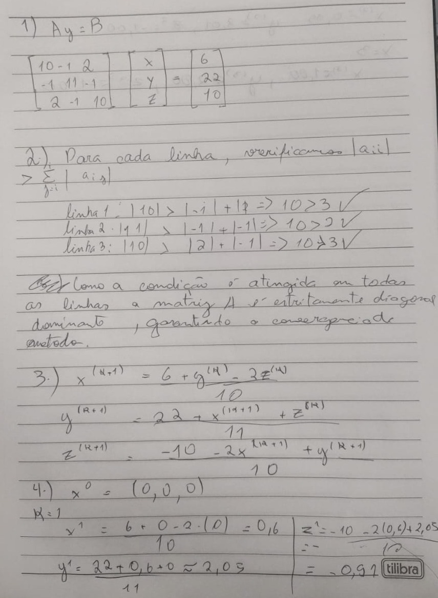
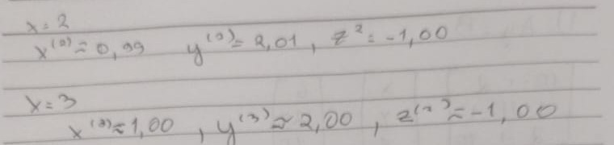
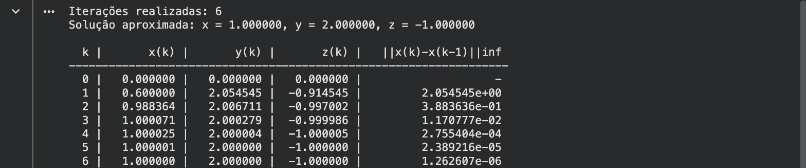
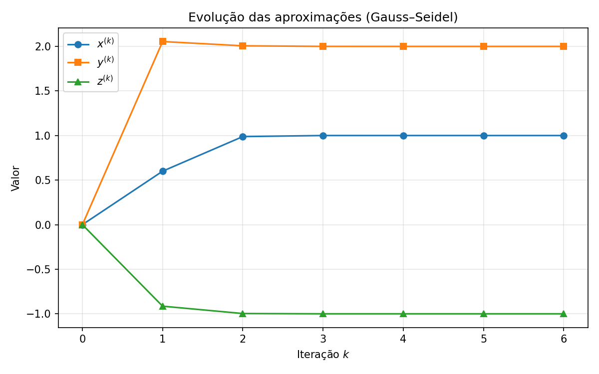
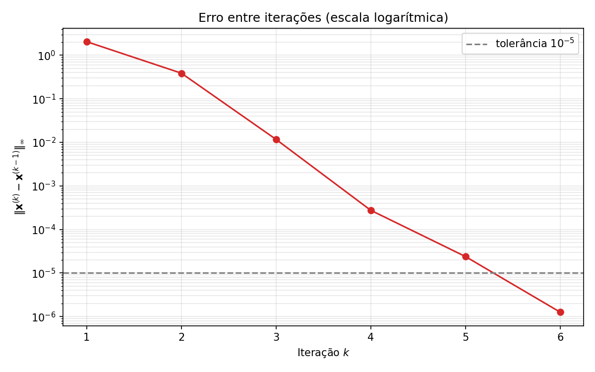

# Método de Gauss–Seidel

Cálculo Numérico — Unifesp · Profa. Raquel Lobosco

Resolução do sistema

$$
\begin{cases}
10x - y + 2z = 6 \\
-x + 11y - z = 22 \\
2x - y + 10z = -10
\end{cases}
$$

pelo método iterativo de Gauss–Seidel, com $\mathbf{x}^{(0)} = (0,0,0)$ e critério de parada $\|\mathbf{x}^{(k)} - \mathbf{x}^{(k-1)}\|_\infty < 10^{-5}$.

**Resultado:** 6 iterações, $x = 1$, $y = 2$, $z = -1$.

[](https://colab.research.google.com/drive/1GbqStQ0ZOwQaq7HbGbg03L2zMRi-9CsU?usp=sharing)

## Resolução à mão (questões 1 a 4)

<p align="center">
  
  <br>
  
</p>

## Implementação (questão 5)

Código em [`gauss_seidel.py`](gauss_seidel.py) e no notebook [`gauss_seidel.ipynb`](gauss_seidel.ipynb).

<p align="center"></p>

## Tabela das iterações (questão 6)

| $k$ | $x^{(k)}$ | $y^{(k)}$ | $z^{(k)}$ | $\|\mathbf{x}^{(k)} - \mathbf{x}^{(k-1)}\|_\infty$ |
|:-:|:-:|:-:|:-:|:-:|
| 0 | 0.000000 | 0.000000 | 0.000000 | — |
| 1 | 0.600000 | 2.054545 | -0.914545 | 2.054545e+00 |
| 2 | 0.988364 | 2.006711 | -0.997002 | 3.883636e-01 |
| 3 | 1.000071 | 2.000279 | -0.999986 | 1.170777e-02 |
| 4 | 1.000025 | 2.000004 | -1.000005 | 2.755404e-04 |
| 5 | 1.000001 | 2.000000 | -1.000000 | 2.389216e-05 |
| 6 | 1.000000 | 2.000000 | -1.000000 | 1.262607e-06 |

## Gráficos (questão 7)

<p align="center">
  
  <br>
  
</p>

## Como rodar

```bash
pip install numpy matplotlib
python gauss_seidel.py
```

A entrega completa em PDF está em [`entrega_gauss_seidel.pdf`](entrega_gauss_seidel.pdf).
